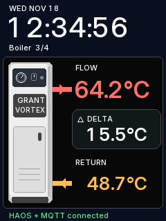
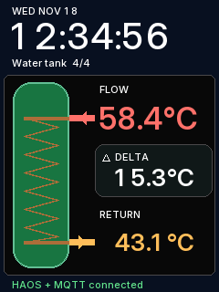

# Home Assistant Heating Panel

A small, live Home Assistant dashboard for a NodeMCU ESP8266 and a portrait
240 x 320 ILI9341 TFT. Configure entities in Home Assistant; changes reach the
screen over MQTT even when no dashboard browser is open.

The screen rotates through a configurable readings grid, optional weather,
a Grant Vortex-style boiler diagram, and a separate green water tank diagram.
Each circuit has a large flow temperature, return temperature, and delta.

| Boiler page | Water tank page |
| --- | --- |
|  |  |

These images contain invented example readings, not installation data.

## Hardware

The display and the sensor nodes are **three separate devices**:

| Device | Hardware | Role |
| --- | --- | --- |
| LCD dashboard | LoLin NodeMCU V3, ESP8266 / ESP-12E | Runs this Arduino sketch; receives readings from Home Assistant through MQTT |
| Water tank sensor node | ESP32-C3 with two water-temperature probes | Measures tank heating flow and return and exposes both as Home Assistant entities |
| Boiler sensor node | Separate ESP32 with BME680 environmental sensor and water-temperature probes | Supplies boiler pipe flow/return and environmental readings to Home Assistant; exact ESP32 board variant is not yet confirmed |

The LCD is **ESP8266, not ESP32-C3**. The BME680 measures environmental conditions;
it is not the water-temperature probe. The exact probe models, sensor-node pin
assignments and boiler ESP32 module variant are not assumed by this repository.
The two sensor nodes already publish to Home Assistant through their own
integration/firmware. That sensor-node firmware is not included or replaced here.
Any other source of compatible Home Assistant sensor entities can also be used.

For the dashboard you need:

- NodeMCU V3 / ESP-12E with 4 MB flash and a stable USB power supply/data cable.
- Non-touch 2.4-inch SPI ILI9341 TFT, 240 x 320 pixels.
- Soldered wiring or suitable jumper wires.
- Home Assistant with its MQTT integration connected to a broker.
- Four temperature entities for the circuit diagrams; optional weather entity
  and separate local temperature sensor for the weather page.

This is a monitoring display. It does not switch the boiler or control heating.

## TFT wiring

| TFT connection | NodeMCU pin | GPIO |
| --- | --- | --- |
| SCK | D5 | 14 |
| MOSI | D7 | 13 |
| CS | D1 | 5 |
| DC | D2 | 4 |
| Backlight control | D8, active high | 15 |
| RST | Software reset (`TFT_RST = -1`) | No GPIO assumed |
| GND | GND | Ground |

Use the power and logic voltage required by your actual TFT breakout. ESP8266
GPIO uses 3.3 V logic. This pin table records the working display wiring;
confirm the breakout's backlight-control requirements and reset wiring before
connecting it. If TFT reset is wired to a GPIO, set `TFT_RST` in `config.h`.
MISO and touch pins are not used. There is no touch interaction or scrolling.

## What is included

- `firmware/ha_panel/`: complete Arduino firmware and smooth Inter font data.
- `custom_components/ha_panel/`: Home Assistant integration with entity pickers.
- `www/ha-panel-card.js`: companion Lovelace card.
- `tools/install_ha_panel.py`: optional standalone integration/card installer.
- `tests/`: synthetic model, weather and installer tests.
- `docs/`: installation notes and generated sample images.

No Wi-Fi names, broker addresses, passwords, API tokens, personal device IDs,
device flash dumps or previously configured binaries are included. Network
settings are entered locally during setup. A Home Assistant REST token is not
required. MQTT is plain TCP and intended for a trusted local network.

## 1. Install the Home Assistant integration

1. Copy `custom_components/ha_panel` into the `custom_components` directory of
   your Home Assistant configuration folder.
2. Copy `www/ha-panel-card.js` into the configuration folder's `www` directory.
3. Restart Home Assistant.
4. In **Settings > Devices & services > Add integration**, add **HA Panel**.
5. Choose a panel ID such as `heating`. It must match the physical display's
   panel ID. IDs use lowercase letters, digits, hyphens or underscores.
6. Open **Configure** to select entities for each reading. The initial sources
   are deliberately empty; no installation-specific entities are assumed.

Alternatively, upload `tools/install_ha_panel.py` into the Home Assistant
configuration folder and execute it from your Home Assistant terminal:

```sh
python3 /config/install_ha_panel.py
```

If your terminal exposes the configuration folder under `/homeassistant`, use
that path instead. The installer supports `--config PATH`, backs up overwritten
integration/card files, and does not restart Home Assistant or edit its main
configuration automatically.

## 2. Configure readings and circuit diagrams

The grid supports four or six configurable readings. Choose a source, label,
optional subtraction entity, decimal places, optional unit override, colour and
optional amber/red thresholds. Select **flow as source** and **return as
subtract** for each delta. Both source units must match.

Use these labels to map readings to the dedicated diagrams regardless of order:

| Diagram role | Recommended label | Source |
| --- | --- | --- |
| Boiler flow | `Boiler flow` | Your boiler flow temperature |
| Boiler return | `Boiler return` | Your boiler return temperature |
| Boiler delta | `Boiler delta` | Boiler flow minus boiler return |
| Tank flow | `Water tank flow` | Your tank flow temperature |
| Tank return | `Water tank return` | Your tank return temperature |
| Tank delta | `Water tank delta` | Tank flow minus tank return |

`Hot press flow`, `Hot press return` and `Hot press rtn` are accepted aliases.
The firmware also accepts generic source IDs `sensor.boiler_flow`,
`sensor.boiler_return`, `sensor.water_tank_flow`, and `sensor.water_tank_return`
when provided in the payload. The diagram shows Celsius readings only.

Both flow **and return** values and pipes are cyan below 30 C, amber at
30 through 50 C inclusive, and red above 50 C. These firmware thresholds are
an approximate visual indication of pipe temperature, not a measured burner
on/off state. Diagram deltas are white and computed from the rounded values
shown on that page, so they remain available even if the grid uses a delta slot
for a different entity. Missing/stale probes show `--` and grey pipes.

Normal text is pure white. Inter glyphs have 16 levels of edge coverage and
are rendered directly in small changed regions without a full-screen buffer.
The clock updates locally and uses the configured POSIX timezone, defaulting
to Ireland/UK daylight-saving rules.

## 3. Weather and rotation

In **Configure > Weather page and page rotation**, enable weather and select
your own Home Assistant weather entity. You can also choose a separate local
temperature sensor. Provider temperature and sensor temperature stay distinct.
Weather starts disabled until a source is configured.

The page shows current conditions, a rain outlook, supplied precipitation
probabilities and three upcoming periods. Hourly forecasts are preferred;
daily or twice-daily forecasts are used when hourly forecasts are unsupported.
The integration refreshes forecasts every 15 minutes and treats them as stale
after an hour. A missing rain probability remains unknown.

With weather enabled: **Readings > Weather > Boiler > Water tank**.
Without weather: **Readings > Boiler > Water tank**.
The interval is configurable from 10 to 300 seconds (default 20).
The normal footer is `HAOS + MQTT connected`; there is no normal IP footer.

## 4. Build the LCD firmware

Install Arduino IDE and the **ESP8266 by ESP8266 Community** board package,
version **3.1.2** used for this project. Its additional board manager URL is:

```text
https://arduino.esp8266.com/stable/package_esp8266com_index.json
```

Install these Library Manager libraries (tested versions):

| Library | Version |
| --- | --- |
| Adafruit GFX Library | 1.13.0 |
| Adafruit ILI9341 | 1.7.0 |
| Adafruit BusIO | 1.17.4 |
| ArduinoJson | 7.4.3 |
| WiFiManager by tzapu | 2.0.17 |
| PubSubClient by Nick O'Leary | 2.8 |

The ESP8266 core supplies Wi-Fi, SPI, EEPROM and time support. Open
`firmware/ha_panel/ha_panel.ino` with its neighbouring `config.h` and `fonts`
folder intact. Check the TFT pins in `config.h`.

Board settings:

- **NodeMCU 1.0 (ESP-12E Module)**, CPU 80 MHz.
- Flash 4 MB, FS 2 MB, OTA approximately 1019 KB.
- Flash mode DIO; upload speed 115200.
- **Erase Flash: Only Sketch** to preserve saved connection settings.
- Select the serial port for your own ESP8266.

With an already configured Arduino CLI installation:

```sh
arduino-cli compile --fqbn esp8266:esp8266:nodemcuv2:eesz=4M2M,xtal=80 firmware/ha_panel
arduino-cli upload --port YOUR_SERIAL_PORT --fqbn esp8266:esp8266:nodemcuv2:eesz=4M2M,xtal=80 firmware/ha_panel
```

Compile your own firmware from this sanitized source. This repository does not
include an installation's configured binary or whole-flash backup.

## 5. Configure the physical display

The default broker setting is empty. On first setup, the display opens a
protected setup Wi-Fi network. Its network name/password and portal address
are shown on the TFT and USB serial output at 115200 baud. Join that network,
open the displayed portal address, and choose **Configure WiFi**.

Enter your Wi-Fi details and MQTT broker hostname, port, username and password.
Set the same panel ID used in Home Assistant. Save and wait for a restart.
A blank MQTT password field preserves a previously saved password.
Credentials are stored on the device and are never required in source control.

The display subscribes to `ha_panel/<panel_id>/state` and reports availability
on `ha_panel/<panel_id>/availability`. Home Assistant publishes retained
snapshots on state changes, coalescing updates, plus a 30-second heartbeat.
After 90 seconds without fresh data, readings become stale. The clock keeps
running. Setup is also offered after sustained connection failure.

If setup appears after an upload, give it time to reconnect and try one normal
restart before re-entering credentials. Check Wi-Fi, MQTT authentication and
matching panel IDs. A successful flash hash check alone does not prove the
panel reconnected: check the connected footer and changing live readings.
Never publish your device's complete flash backup; it may contain credentials.

## Optional Home Assistant dashboard card

Add `/local/ha-panel-card.js?v=3` as a JavaScript module dashboard resource.
Then add a Manual card:

```yaml
type: custom:ha-panel-card
entity: sensor.ha_panel_heating
```

Choose your actual HA Panel sensor if its entity ID differs. The visual editor
also has a sensor picker. The card's cog opens integration settings; tapping a
reading opens the underlying source entity. The card has readings/weather tabs;
the boiler and tank diagrams are rendered by the physical TFT firmware.

## Validation

From the repository root:

```sh
python -m unittest discover -s tests
node --check www/ha-panel-card.js
```

The models are tested with synthetic values, unavailable entities, unit
mismatches, thresholds, forecast probabilities and Celsius encoding. The
installer is checked for repeatability and backups. The sanitized sketch is
compiled for the board configuration above. Hardware visuals and reconnecting
have been tested on a NodeMCU/ILI9341 installation, not every ESP8266 breakout.

## License and acknowledgements

Original project code and documentation are licensed under **MIT**; see
[LICENSE](LICENSE). Inter font data retains the **SIL Open Font License 1.1**
in [fonts/OFL.txt](firmware/ha_panel/fonts/OFL.txt). Dependencies retain their
own licenses and are installed separately. See [NOTICE](NOTICE).

Grant Vortex is used as a descriptive reference for the illustrated boiler.
This project is not affiliated with or endorsed by the boiler manufacturer.
